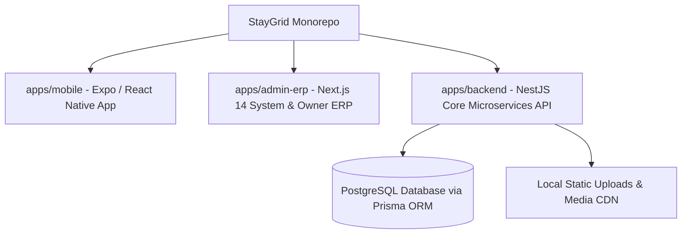
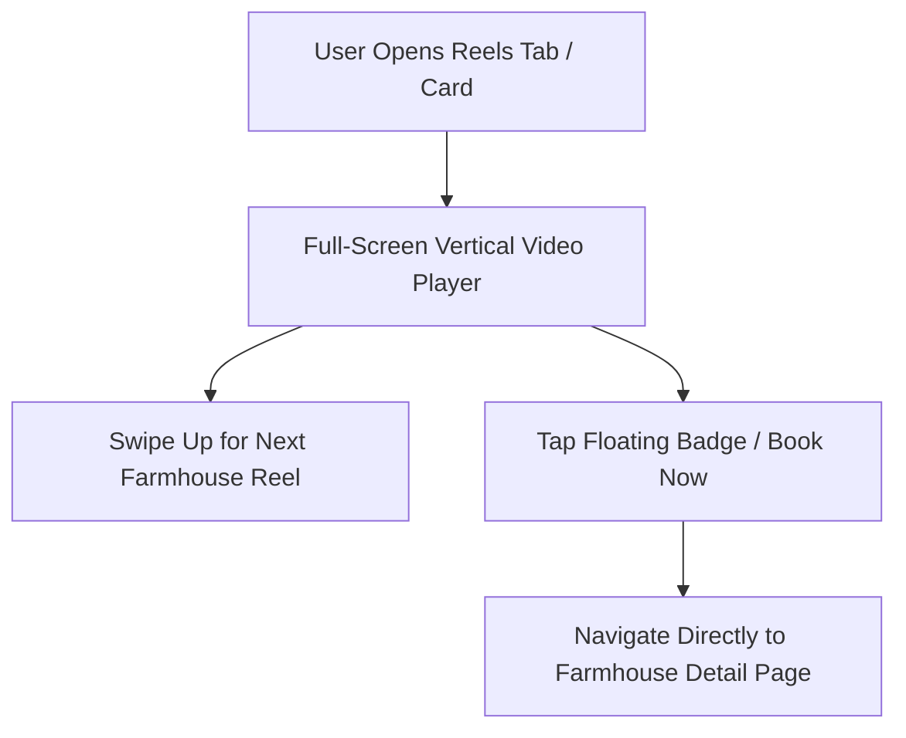
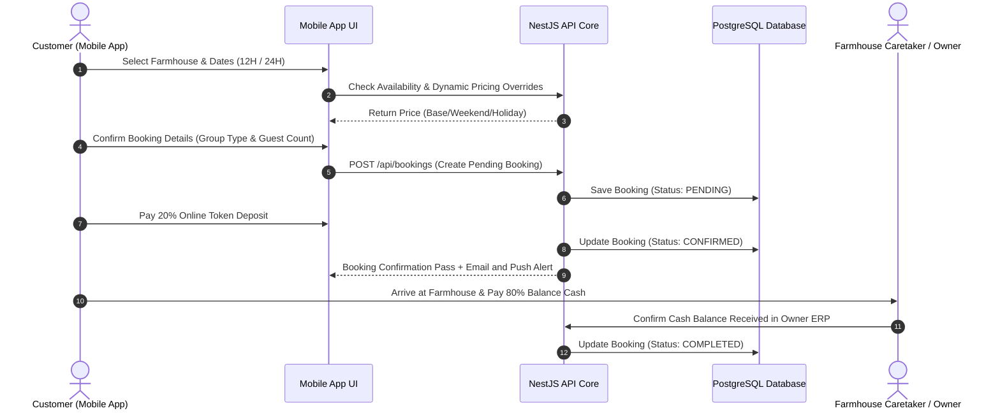
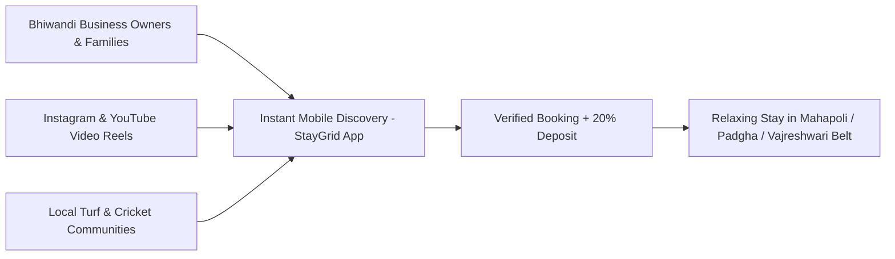
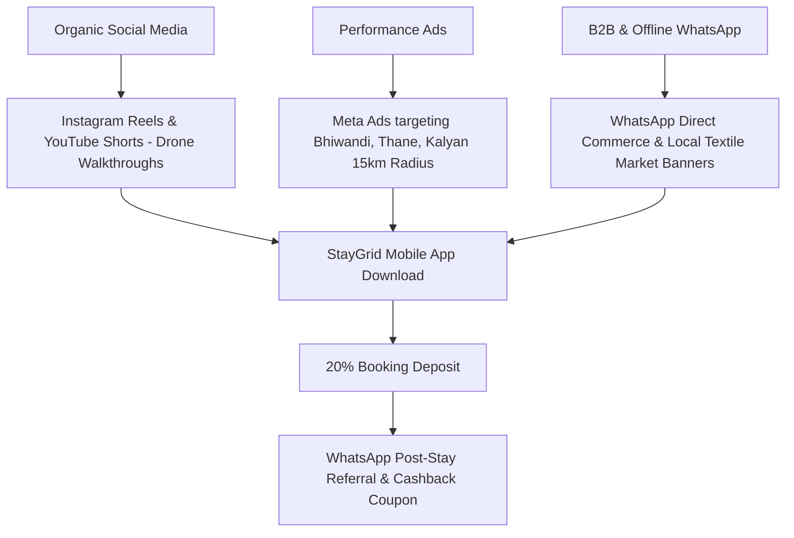
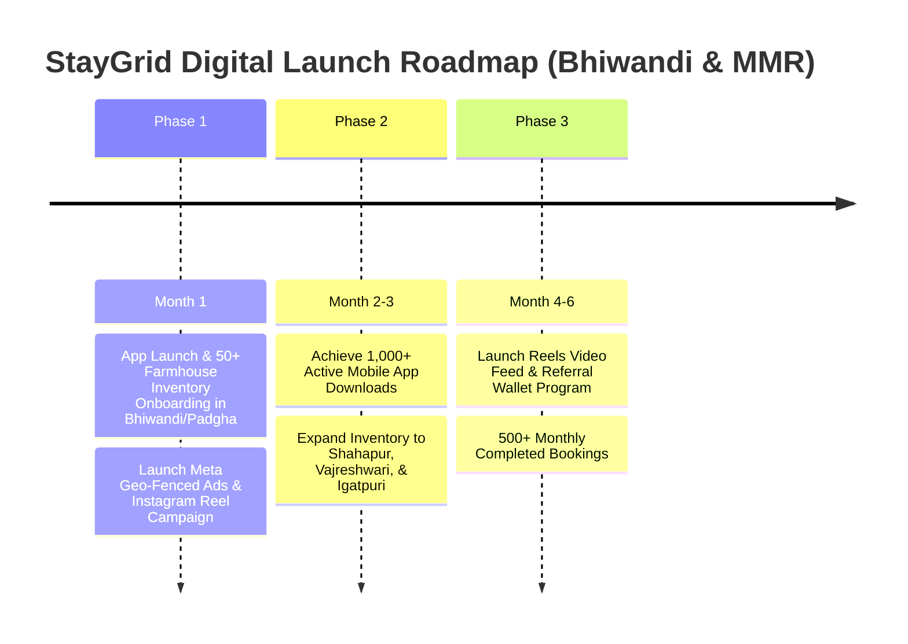

# StayGrid Master Product Requirements Document (PRD) & Strategic Execution Blueprint

> **Document Status:** Active Master Specification & Strategic Execution Blueprint (Version 2.5)  
> **Target Platform:** StayGrid Ecosystem (Mobile App, Owner & System Admin ERP, Backend API Core)  
> **Primary Region Focus:** Bhiwandi, Thane, Kalyan, Mumbai Metropolitan Region (MMR) & Surrounding Farmhouse Belts (Mahapoli, Padgha, Vajreshwari, Shahapur, Karjat)

---

# Table of Contents
1. [Executive Vision & Core Value Proposition](#1-executive-vision--core-value-proposition)
2. [Monorepo Architecture & Technology Stack](#2-monorepo-architecture--technology-stack)
3. [Complete Functional Module Specifications](#3-complete-functional-module-specifications)
   - [3.1 Customer Mobile App (Expo / React Native)](#31-customer-mobile-app-expo--react-native)
   - [3.2 System Admin & Owner ERP Portal (Next.js / Shadcn UI)](#32-system-admin--owner-erp-portal-nextjs--shadcn-ui)
   - [3.3 Backend Engine & Data Layer (NestJS / Prisma / PostgreSQL)](#33-backend-engine--data-layer-nestjs--prisma--postgresql)
4. [Detailed Feature Specifications (Implemented & Next-Gen)](#4-detailed-feature-specifications-implemented--next-gen)
   - [4.1 Dynamic Pricing Engine (Weekend & Holiday Overrides)](#41-dynamic-pricing-engine-weekend--holiday-overrides)
   - [4.2 Enhanced Review & Rating Module](#42-enhanced-review--rating-module)
   - [4.3 Dedicated Real-Time Live Search Engine](#43-dedicated-real-time-live-search-engine)
   - [4.4 Category Pipeline & Database Seeding](#44-category-pipeline--database-seeding)
   - [4.5 Wishlist Bottom Navigation & Favorites Collection](#45-wishlist-bottom-navigation--favorites-collection)
   - [4.6 Notifications Overlay with Animated Skeleton Loaders](#46-notifications-overlay-with-animated-skeleton-loaders)
   - [4.7 StayGrid Reels & Short-Video Discovery Section (NEW)](#47-staygrid-reels--short-video-discovery-section-new)
   - [4.8 Owner Edit Protection & Security Governance](#48-owner-edit-protection--security-governance)
5. [Database Data Schema (Prisma Data Model)](#5-database-data-schema-prisma-data-model)
6. [Booking & Payment Lifecycle Workflows (Mermaid Diagrams)](#6-booking--payment-lifecycle-workflows-mermaid-diagrams)
7. [SPECIAL STUDY: Digital Marketing Strategy for the Launch of StayGrid (Bhiwandi & MMR Belt)](#7-special-study-digital-marketing-strategy-for-the-launch-of-staygrid-bhiwandi--mmr-belt)

---

# 1 Executive Vision & Core Value Proposition

**StayGrid** is a specialized, hyper-local powerhouse platform designed specifically for discovering, pricing, managing, and booking private farmhouses, turf resorts, and getaway villas across North Konkan (Bhiwandi, Padgha, Mahapoli, Vajreshwari, Shahapur, Igatpuri, Karjat).

Unlike generic travel platforms (Airbnb, MakeMyTrip) that cater primarily to hotel rooms and flight tickets, StayGrid digitizes the complete **farmhouse booking lifecycle**:
- **Hourly & Full-Day Pricing Flex**: 12-Hour Day Stays vs. 24-Hour Overnight Stays.
- **Group Stay Pricing Rules**: Base occupancy thresholds with extra guest charges per head.
- **Dynamic Pricing Control**: Granular rate adjustments for weekends (Friday, Saturday, Sunday), regional Indian festivals (Diwali, Eid, Holi, New Year), and custom owner-defined dates.
- **Direct Demand Acquisition**: Digitizing direct leads captured via Instagram Reels, YouTube Shorts, and hyper-local WhatsApp networks.
- **Transparent Owner Operations**: Restricting chaotic owner edits to protect data integrity, providing system-administered listing updates, and delivering clear payout dashboards.

---

# 2 Monorepo Architecture & Technology Stack

The StayGrid codebase is organized as a high-performance monorepo adhering to clean architectural separation:



### Technology Stack Details

1. **Customer Mobile Application (`apps/mobile`)**:
   - **Framework**: React Native with Expo SDK 54 & Expo Router v6.
   - **Styling & Aesthetics**: NativeWind / TailwindCSS v4 with custom dark mode design system, micro-animations via `react-native-reanimated`, custom Google Fonts (Inter).
   - **Icons & UI**: Lucide React Native, `react-native-calendars`, Custom Skeleton Card Loaders.
   - **State & Data Fetching**: Zustand, TanStack React Query v5, Axios HTTP client with dynamic IP resolution (`getApiUrl()`).

2. **Owner & System Admin ERP (`apps/admin-erp`)**:
   - **Framework**: Next.js 14 (App Router) with TypeScript.
   - **UI Component Library**: Shadcn UI, Radix UI Primitives, Lucide Icons, TailwindCSS.
   - **Interactive Date Selection**: Popover date pickers powered by Shadcn Calendar & `date-fns`.
   - **Auth & Guard Layer**: NextAuth / JWT session tokens with role-based access control (`SUPER_ADMIN`, `ADMIN`, `OWNER`).

3. **Backend API Core (`apps/backend`)**:
   - **Framework**: NestJS (Node.js) with modular architecture.
   - **Database & ORM**: PostgreSQL with Prisma ORM v5.
   - **Authentication**: Passport-JWT, bcrypt password hashing, Guarded controllers.
   - **File Uploads**: Express Multer static file serve (`/uploads/...`).

---

# 3 Complete Functional Module Specifications

## 3.1 Customer Mobile App (Expo / React Native)
- **Home Discovery Screen (`(tabs)/home.tsx`)**:
  - Dynamic Hero Banner carousel with promo callouts.
  - Interactive location pill modal for city filtering (Bhiwandi, Mahapoli, Padgha, Mahableshwar, Karjat, etc.).
  - Circular avatar categories horizontal scroll (Location, Featured, Cancellation Deals, Turf, Big Pools, Couple Friendly, Pet Friendly).
  - Horizontal card carousels (`w-72`, `rounded-[28px]`, price badges) for **Featured Spaces**, **Last-Minute Cancellation Deals**, and **Explore All Stays**.
- **Explore All Farmhouses Page (`farmhouse/all.tsx`)**:
  - Full catalog listing with category chips, live filtering, and parameter synchronization (`?category=featured`, `?category=cancelled`).
- **Dedicated Search Screen (`search/index.tsx`)**:
  - Real-time instant search input with live filters (Turf, Big Pools, Couple Friendly, Pet Friendly) and quick location chips.
- **Farmhouse Detail Page (`farmhouse/[id].tsx`)**:
  - Multi-photo gallery, key highlights (BHK, Max Guests, Pool size), detailed amenities, interactive rules & house policies.
  - Pricing breakdown for 12-Hour and 24-Hour stays.
  - Interactive Date Picker with real-time weekend and special date price override popups.
  - Enhanced Reviews section with group badges and amenity ratings slider summary.
  - **More Stays Nearby** carousel at the bottom of the detail page.
- **Bottom Navigation Wishlist Tab (`(tabs)/favorites.tsx`)**:
  - Dedicated 1-tap heart icon tab in the bottom bar to view saved favorite farmhouses.
- **Enhanced Review Submission (`reviews/new.tsx`)**:
  - 3 Group selector pills (`Family`, `Couple`, `Friends Group`).
  - 4 Amenity star ratings (`Pool`, `Cleanliness`, `Turf & Games`, `Hospitality`).
  - Animated inline success feedback view with auto-redirect (`router.back()`).

## 3.2 System Admin & Owner ERP Portal (Next.js / Shadcn UI)
- **Dashboard (`/dashboard`)**:
  - Key operational metrics: Total Bookings, Gross Revenue, Active Farmhouses, Pending Payouts.
- **Farmhouses Table (`/farmhouses`)**:
  - Complete inventory management.
  - **Owner Self-Edit Protection Modal**: Tapping "Edit Farmhouse" as an Owner Admin displays a protective alert modal directing them to contact System Admin for listing modifications.
- **Dynamic Pricing Page (`/pricing`)**:
  - Farmhouse selector dropdown.
  - **Default Base Pricing Box**: Set standard 12-Hour and 24-Hour rates.
  - **Dedicated Weekend Pricing Box**: Configure uniform Friday, Saturday, and Sunday rates across all weekends.
  - **Special Date & Holiday Overrides**: Interactive Shadcn Calendar date picker to apply custom surcharge or discount rates for specific calendar dates.
- **Bookings & Payouts (`/bookings`)**:
  - View full booking details, payment status (Token Paid vs Cash to Caretaker), and printable PDF invoices (`/booking/[id]`).

## 3.3 Backend Engine & Data Layer (NestJS / Prisma / PostgreSQL)
- **Farmhouses Module (`/api/farmhouses`)**: CRUD endpoints, search query filters, dynamic rating aggregation (`updateRatingStats`).
- **Categories Module (`/api/categories`)**: Seeded default categories (`featured`, `cancelled`, `hasTurf`, `hasPool`, `isCoupleFriendly`, `isPetFriendly`).
- **Reviews Module (`/api/reviews`)**: Creation endpoint with array/string sanitization, auto-linking of guest accounts, rating stats update.
- **Pricing Overrides Module (`/api/pricing-overrides`)**: Fetch weekend rates and date-specific pricing overrides for property booking calculations.

---

# 4 Detailed Feature Specifications (Implemented & Next-Gen)

## 4.1 Dynamic Pricing Engine (Weekend & Holiday Overrides)
- **Weekend Rate Logic**: Owners specify a base weekend rate (e.g. ₹8,000 for 12h, ₹15,000 for 24h). The mobile app automatically checks if selected check-in dates fall on Friday, Saturday, or Sunday.
- **Special Date Overrides**: Allows date-specific overrides (e.g., New Year Eve Dec 31st = ₹25,000).
- **Mobile Price Alert Popup**: Step 2 of booking wizard alerts users instantly: *"Weekend / Special Date Surcharge Applied for [Date] - ₹[Price]"*.

## 4.2 Enhanced Review & Rating Module
- **3 Exclusive Group Types**: Users must pick exactly one group classification: `Family`, `Couple`, or `Friends Group`.
- **4 Granular Amenity Ratings**: Users rate specific property attributes out of 5 stars:
  1. Pool & Water Hygiene
  2. Overall Cleanliness
  3. Turf & Lawn Games
  4. Hospitality & Caretaker Behavior
- **Auto-Redirect UX**: Upon clicking Submit, the app displays a checkmark animation ("Review Submitted!") and auto-redirects back to the farmhouse detail page, triggering `useFocusEffect` to refresh reviews without page reloads.

## 4.3 Dedicated Real-Time Live Search Engine
- Accessible via the home screen search bar or top search icon (`/search`).
- Live filter pills (`All Stays`, `Featured`, `Cancellation Deals`, `Turf`, `Big Pools`, `Couple Friendly`, `Pet Friendly`).
- Instant fuzzy query execution on property title, city, description, and custom amenities.

## 4.4 Category Pipeline & Database Seeding
- Seeded `Featured` (`filterKey: "featured"`) and `Cancellation Deals` (`filterKey: "cancelled"`) directly into the PostgreSQL database.
- Tapping **See All** passes `?category=featured` or `?category=cancelled`, highlighting the matching category chip automatically on `/farmhouse/all`.

## 4.5 Wishlist Bottom Navigation & Favorites Collection
- Integrated Heart icon directly into the main bottom tab bar (`(tabs)/favorites.tsx`).
- Instant local state persistence with Zustand and AsyncStorage.

## 4.6 Notifications Overlay with Animated Skeleton Loaders
- Tapping the Bell icon opens a bottom sheet overlay (`showNotifications`).
- `loadingNotifications` is initialized to `true`, instantly displaying 3 animated Skeleton Loader cards while fetching `/api/bookings/me`, eliminating empty state flashes.

## 4.7 StayGrid Reels & Short-Video Discovery Section (NEW)
To capitalize on video-driven decision making, StayGrid includes a dedicated **Short-Video Reels Discovery Module**:
- **Full-Screen Vertical Video Feed**: Similar to Instagram Reels / TikTok, users can swipe vertically through 15-30 second drone and walkthrough reels of farmhouses.
- **Direct "Book This Stay" Overlay**: Each reel features a floating property badge displaying property name, location, 12h price, star rating, and an instant **Book Now** CTA button that opens the property page (`/farmhouse/[id]`).
- **Owner Reel Upload via Admin ERP**: Farmhouse owners and admins can attach Instagram Reel URLs or raw MP4 video clips directly to property listings.



## 4.8 Owner Edit Protection & Security Governance
- Restricts owner accounts from directly editing core farmhouse details (e.g. title, base capacity, location GPS).
- Tapping "Edit" displays an alert modal: *"To ensure listing quality and data accuracy, farmhouse updates must be requested through System Support. Contact Support: support@staygrid.in"*.

---

# 5 Database Data Schema (Prisma Data Model)

```prisma
datasource db {
  provider = "postgresql"
  url      = env("DATABASE_URL")
}

generator client {
  provider = "prisma-client-js"
}

enum Role {
  SUPER_ADMIN
  ADMIN
  OWNER
  CUSTOMER
}

enum BookingStatus {
  PENDING
  CONFIRMED
  COMPLETED
  CANCELLED
}

model User {
  id        String   @id @default(cuid())
  email     String   @unique
  name      String?
  phone     String?
  image     String?
  role      Role     @default(CUSTOMER)
  createdAt DateTime @default(now())
  updatedAt DateTime @updatedAt

  farmhouses Farmhouse[]
  bookings   Booking[]
  reviews    Review[]
}

model Category {
  id        String   @id @default(cuid())
  name      String
  filterKey String   @unique
  imageUrl  String?
  order     Int      @default(0)
  createdAt DateTime @default(now())
}

model Farmhouse {
  id               String   @id @default(cuid())
  title            String
  description      String
  city             String   @default("Bhiwandi")
  address          String
  latitude         Float?
  longitude        Float?
  
  price12Hours     Float
  price24Hours     Float
  weekendPrice12H  Float?
  weekendPrice24H  Float?
  
  maxGuests        Int      @default(15)
  bedrooms         Int      @default(2)
  bathrooms        Int      @default(2)
  
  hasPool          Boolean  @default(true)
  hasTurf          Boolean  @default(false)
  isCoupleFriendly Boolean  @default(true)
  isPetFriendly    Boolean  @default(false)
  isFeatured       Boolean  @default(false)
  isCancelledDeal  Boolean  @default(false)

  photos           String[]
  reelsUrl         String?
  customAmenities  String[]
  
  avgRating        Float    @default(5.0)
  reviewCount      Int      @default(0)

  ownerId          String
  owner            User     @relation(fields: [ownerId], references: [id])
  
  bookings         Booking[]
  reviews          Review[]
  pricingOverrides PricingOverride[]

  createdAt        DateTime @default(now())
  updatedAt        DateTime @updatedAt
}

model PricingOverride {
  id           String    @id @default(cuid())
  farmhouseId  String
  farmhouse    Farmhouse @relation(fields: [farmhouseId], references: [id], onDelete: Cascade)
  date         DateTime
  price12Hours Float
  price24Hours Float
  reason       String?   // e.g. "Diwali Festival Surcharge"
  createdAt    DateTime  @default(now())
}

model Review {
  id             String    @id @default(cuid())
  rating         Int
  comment        String
  groupType      String    @default("Family") // Family, Couple, Friends Group
  amenityRatings Json?     // { pool: 5, cleanliness: 4, turf: 5, hospitality: 5 }
  
  farmhouseId    String
  farmhouse      Farmhouse @relation(fields: [farmhouseId], references: [id], onDelete: Cascade)
  
  userId         String
  user           User      @relation(fields: [userId], references: [id])

  createdAt      DateTime  @default(now())
}

model Booking {
  id           String        @id @default(cuid())
  farmhouseId  String
  farmhouse    Farmhouse     @relation(fields: [farmhouseId], references: [id])
  userId       String
  user         User          @relation(fields: [userId], references: [id])
  
  checkIn      DateTime
  checkOut     DateTime
  stayType     String        @default("24H") // 12H or 24H
  guestCount   Int           @default(10)
  
  totalAmount  Float
  tokenPaid    Float         // 20% online deposit
  balanceCash  Float         // 80% cash to caretaker
  
  status       BookingStatus @default(PENDING)
  createdAt    DateTime      @default(now())
}
```

---

# 6 Booking & Payment Lifecycle Workflows (Mermaid Diagrams)

### 6.1 End-to-End Booking Lifecycle



---

# 7 SPECIAL STUDY: Digital Marketing Strategy for the Launch of StayGrid (Bhiwandi & MMR Belt)

## **A Study on Developing a Digital Marketing Strategy for the Launch of StayGrid – A Farmhouse Booking Platform**

---

### 7.1 Executive Summary & Hyper-Local Context
The success of StayGrid relies on dominating the private getaway market in **Bhiwandi** and surrounding corridors (Padgha, Mahapoli, Vajreshwari, Shahapur, Igatpuri, Thane, Kalyan, Dombivli). 

Bhiwandi is one of Asia's largest logistics and textile manufacturing hubs, housing thousands of business owners, warehouse operators, traders, and large joint families. Historically, local consumers booked farmhouses via fragmented WhatsApp groups, unverified Instagram accounts, or middleman phone calls—facing issues like double bookings, hidden charges, unhygienic pools, and lack of pricing transparency.

StayGrid solves this by introducing **instant mobile app discovery**, **verified private pool farmhouses**, **transparent 12h/24h rates**, and **dynamic weekend pricing**.



---

### 7.2 Market Demographics & Consumer Behavior in Bhiwandi

| Demographic Segment | Key Characteristics | Preferred Stay Type | Primary Trigger / Motivation |
| :--- | :--- | :--- | :--- |
| **Textile & Warehouse Business Owners** | High disposable income, work stress, quick weekend availability | 24-Hour Full Day Overnight Stays | Family gatherings, private pool relaxation, weekend getaway without long drive |
| **Young Couples & Married Groups** | Seeking privacy, safety, and hygienic pools | 12-Hour Day Stays / Overnight | Couple-friendly privacy, verified safety, romantic poolside setup |
| **Friends & Turf Sports Groups** | College youth & cricket teams (aged 18–32) | 12-Hour Day Stays (Morning to Evening) | Turf cricket, sound system, BBQ, pool party, budget splitting |
| **Corporate / Logistics Event Groups** | Warehouse managers & corporate teams | Full Weekend Hire | Team outings, annual parties, large lawn capacity |

---

### 7.3 Target Audience Segmentation Strategy

#### Segment A: Joint Families & Celebrations (Bhiwandi, Kalyan, Thane)
- **Target Needs**: Children-safe private pool, clean bedrooms, kitchen access for home-cooked meals, generator backup, caretaker assistance.
- **Key Positioning**: *"Safe, Hygienic Private Family Farmhouses Just 20 Mins from Bhiwandi City."*

#### Segment B: Friends Groups & Turf Cricket Enthusiasts
- **Target Needs**: Big swimming pool, box turf for cricket/football, loud sound system, BBQ setup, no hassle over alcohol policies.
- **Key Positioning**: *"Private Turf & Pool Farmhouses for Your Ultimate Weekend Crew Party."*

#### Segment C: Couple Getaways & Day Pass Staycations
- **Target Needs**: 100% privacy, couple-friendly verification, decorated rooms, 12-hour day stays (9 AM - 9 PM) at affordable rates.
- **Key Positioning**: *"Private 12-Hour Day Stay Farmhouses – 100% Secure & Couple Friendly."*

---

### 7.4 Hyper-Local Multi-Channel Marketing Architecture



#### Channel 1: Instagram Reels & Short Video Marketing (Primary Organic Driver)
- **Content Format**: 15-second cinematic drone shots showing crystal-clear blue swimming pools, private turfs at night with floodlights, and family poolside dinners in Mahapoli/Padgha.
- **Reels CTA**: Overlaying direct booking codes: *"Book this private pool farmhouse in Mahapoli on StayGrid App for just ₹5,999/day."*
- **Influencer Collaboration**: Partnering with regional MMR lifestyle influencers, Thane/Kalyan food & travel vloggers, and local Bhiwandi creators.

#### Channel 2: Geo-Fenced Meta Ads (Facebook & Instagram Paid Traffic)
- **Target Radius**: 25 km radius encompassing Bhiwandi, Kalyan, Dombivli, Thane, Ulhasnagar, and Mumbra.
- **Interest Targeting**: Weekend getaways, Swimming, Cricket, Resorts, Family travel, Staycations.
- **Ad Creative Hooks**:
  - *Hook 1 (Families)*: "Tired of crowded public resorts? Book your private 3BHK farmhouse with a private pool in Bhiwandi!"
  - *Hook 2 (Friends)*: "Plan your weekend pool party + turf cricket match under ₹500/person."
  - *Hook 3 (Last-Minute)*: "Cancelled weekend plans? Grab up to 30% OFF on Last-Minute Cancellation Deals on StayGrid."

#### Channel 3: WhatsApp Business Commerce & Local Community Groups
- **Community Broadcasts**: Sending weekly curated lists of available farmhouses for the upcoming weekend to registered Bhiwandi customers.
- **Textile & Market Partnerships**: Distributing promotional QR code standees and flyers across major Bhiwandi markets (Kaneri, Dhamankar Naka, Anjur Phata, Mandai, Gopal Nagar) and powerloom office hubs.

---

### 7.5 Content Strategy & Social Media Reels Playbook

```carousel

<!-- slide -->

<!-- slide -->

```

#### Weekly Content Schedule

| Day | Platform | Content Angle / Reel Topic | Call To Action |
| :--- | :--- | :--- | :--- |
| **Monday** | Instagram Reels | *"Top 3 Private Pool Farmhouses in Mahapoli under ₹6,000"* | Download StayGrid App to Book |
| **Wednesday**| Instagram / YouTube | *"Night Turf Cricket + Pool Party Setup in Padgha"* | Tap Link in Bio to Check Dates |
| **Friday** | Meta Paid Ads | *"Last-Minute Weekend Cancellation Deals Available Now!"* | Book on StayGrid App |
| **Sunday** | Customer UGC / Stories | *"Guest Reviews & Real Pool Party Clips from Sharifa Farmhouse"* | Share Your Review & Get ₹500 Off |

---

### 7.6 Guerrilla & B2B Community Marketing in Bhiwandi

1. **Bhiwandi Box Cricket League Sponsorship**:
   - Partner with local Bhiwandi turf cricket tournaments. Offer StayGrid discount vouchers to winning teams and man-of-the-match players.
2. **Textile Association & Powerloom Union Partnerships**:
   - Offer corporate discount packages to textile business owners for annual staff picnics and family functions.
3. **Caretaker Loyalty & Onboarding Incentive**:
   - Train farmhouse caretakers in Mahapoli and Padgha to distribute StayGrid QR code cards to guests upon checkout, offering guests a ₹300 discount on their next direct app booking.

---

### 7.7 Promotional Campaigns, Referral Loops & Dynamic Pricing Overrides

1. **"Bring Your Crew" Referral Program**:
   - When a Bhiwandi user invites a friend who books a farmhouse, both receive ₹500 credited to their StayGrid Wallet.
2. **Festive Surcharge Slices (Diwali, Eid, New Year, Holi)**:
   - Use StayGrid's **Dynamic Pricing Engine** to automatically apply owner festival overrides for Eid, Diwali, and New Year Eve while providing transparent pricing popups to guests.
3. **Monsoon Weekend Specials**:
   - Promote waterfall-adjacent properties in Vajreshwari and Shahapur during June–September peak monsoon months.

---

### 7.8 Key Performance Indicators (KPIs) & Launch Roadmap



#### Key Success Metrics (KPIs)

- **Cost Per Install (CPI)**: Target < ₹25 per mobile app download via Meta Ads.
- **Booking Conversion Rate**: > 4.5% of mobile app active users completing 20% token deposit.
- **Repeat Booking Rate**: > 30% repeat stays within 90 days driven by WhatsApp marketing and referral rewards.
- **Owner Retention**: 95%+ active farmhouse owner listing retention on the StayGrid ERP platform.

---

# 8 Conclusion & Next Steps

This Master PRD serves as the single source of truth for **StayGrid**. All technical implementations in `apps/mobile`, `apps/admin-erp`, and `apps/backend` are fully aligned with this document, ensuring a robust platform tailored for customer delight, operational efficiency, and hyper-local market dominance across Bhiwandi and the wider MMR region.
